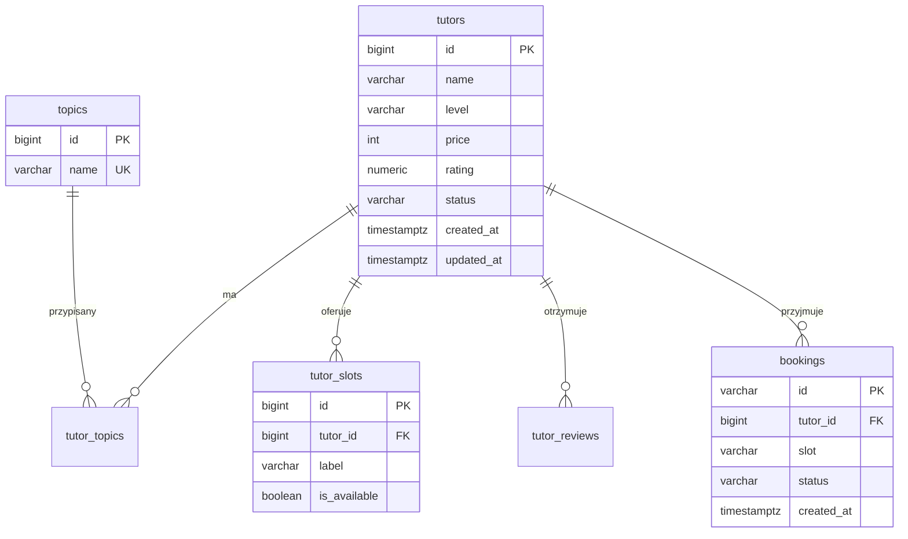

# Lab 7/8 — PostgreSQL, PDO, repozytoria i mapowanie obiektów

Data: 2026-11-27  
Zakres: Lab 7 (PostgreSQL, SQL, PDO) i Lab 8 (modele, repozytoria, CRUD, mapowanie wierszy na obiekty).  
Branch: `feature/lab7-8-database` (na `feature/auth-ui`; auth UI nadal nie jest zmergowane).

## 1. Co zostało zrobione

- PostgreSQL 16 w Dockerze, schemat i dane demo w `database/`.
- `pdo_pgsql` w obrazie PHP; połączenie przez `App\Database`.
- Encje `App\Models\Tutor` i `App\Models\Booking`.
- Repozytoria `TutorRepository` i `BookingRepository`.
- `TutorRepository`: odczyt listy/profilu, filtrowanie, CRUD, mapowanie tematów, slotów i opinii.
- `BookingRepository`: zapis rezerwacji w transakcji, blokada slotu `FOR UPDATE`, odczyt po ID i lista.
- Kontrolery i widoki korzystają z obiektów, nie z tablic z sesji/statycznego katalogu.
- Usunięte `TutorCatalog` i `BookingStore`.
- `/dashboard` czyta rezerwacje z bazy.
- Test czystej bazy: `docker compose down -v` + inicjalizacja z plików SQL.

## 2. Wymagania Lab 7

| Wymaganie | Realizacja |
|---|---|
| PostgreSQL w Dockerze | usługa `db`, wolumen `pg-data`, healthcheck |
| `pdo_pgsql` | `docker/php/Dockerfile` |
| tabela danych | `tutors`, `topics`, `tutor_topics`, `tutor_slots`, `tutor_reviews`, `bookings` |
| klasa `Database` | `src/Database.php`, metoda `connect(): PDO` |
| model danych | `src/Models/Tutor.php` |
| repozytorium | `src/Repository/TutorRepository.php` |
| CRUD | `save()`, `update()`, `delete()`, `find()`, `findAll()` |
| mapowanie | jawny `mapRow()` + `FETCH_ASSOC` |
| prepared statements | wszystkie zapytania z parametrami |
| min. 3 rekordy w różnych statusach | 4 rezerwacje demo: `pending`, `accepted`, `completed`, `cancelled` |
| wyświetlanie danych | `/tutors`, `/tutors/{id}`, `/dashboard` |
| walidacja po stronie DB | `CHECK` dla poziomu, ceny, ocen, statusów; FK |

## 3. Wymagania Lab 8

| Wymaganie | Realizacja |
|---|---|
| Entity | `Tutor`, `Booking` — `final`, typowane, readonly |
| DTO / Value Object | status rezerwacji jako kontrolowany zbiór + `statusLabel()`; brak `mixed` w encjach |
| `FETCH_ASSOC` | domyślny tryb PDO i ręczne mapowanie |
| `FETCH_OBJ` / `FETCH_CLASS` | świadomie nieużywane: `FETCH_CLASS` omija konstruktor i wymaga publicznych pól |
| mapowanie | `TutorRepository::mapRow()`, `BookingRepository::mapRow()` |
| repozytorium | SQL w jednym miejscu, kontroler nie zna PDO |
| CRUD | `TutorRepository` — pełny CRUD; `BookingRepository` — create/read |
| relacje | `topics`, `slots`, `reviews` ładowane wsadowo i przekazywane do encji |

## 4. Architektura

```text
public/index.php (composition root)
        │
        ├── App\Database ──► PDO
        ├── TutorRepository(PDO)
        └── BookingRepository(PDO)
                │
                ▼
        Controller (App\Controller\*)
                │  encje / dane widoku
                ▼
        AppController::render() ──► layout + widok
```

Nie używamy singletona. Jedno połączenie PDO powstaje w `public/index.php`, a repozytoria dostają je przez konstruktor. Dzięki temu można je podmienić w teście i nie ma globalnego stanu.

`App\Routing` przyjmuje opcjonalną fabrykę kontrolerów. W `public/index.php` fabryka wybiera kontroler i wstrzykuje mu repozytoria:

```php
$controllerFactory = static function (string $class) use ($tutorRepository, $bookingRepository): AppController {
    return match ($class) {
        TutorController::class => new TutorController($tutorRepository),
        BookingController::class => new BookingController($tutorRepository, $bookingRepository),
        DashboardController::class => new DashboardController($bookingRepository),
        // ...
    };
};
```

## 5. Schemat i ERD



Kluczowe ograniczenia:

- `tutors.level` — `Podstawa`, `Rozszerzenie`, `Podstawa i rozszerzenie`;
- `tutors.status` — `active`, `pending`, `hidden`;
- `bookings.status` — `pending`, `accepted`, `completed`, `cancelled`, `declined`;
- `tutor_slots` — unikalny `(tutor_id, label)`;
- `tutor_topics` — klucz złożony i FK;
- trigger `tutors_set_updated_at` aktualizuje `updated_at`.

## 6. Mapowanie

`TutorRepository::hydrate()` pobiera wiersze encji, a następnie jednym zapytaniem na relację dociąga tematy, dostępne terminy i opinie. `mapRow()` tworzy `Tutor` z typowanymi polami; widok nie widzi już kształtu wiersza SQL.

`BookingRepository::mapRow()` robi JOIN z `tutors`, żeby encja miała `tutorName`, i normalizuje `created_at` do formatu widoku.

Świadomie nie używamy `PDO::FETCH_CLASS`:

- omija konstruktor encji,
- wymaga publicznych właściwości,
- utrudnia kontrolę typów i readonly,
- miesza kształt bazy z obiektem domenowym.

## 7. Transakcja rezerwacji

`BookingRepository::save()`:

1. `beginTransaction()`,
2. `SELECT id FROM tutor_slots ... WHERE is_available = TRUE FOR UPDATE`,
3. brak wiersza → `SlotUnavailableException`,
4. `UPDATE tutor_slots SET is_available = FALSE`,
5. `INSERT INTO bookings`,
6. `commit()`; wyjątek → `rollBack()`.

Dzięki `FOR UPDATE` dwa równoległe żądania nie zajmą tego samego terminu. Test wywołania repozytorium na zajętym slocie rzucił oczekiwany wyjątek, a liczba rezerwacji pozostała bez zmian (test wykonany na chwilowej rezerwacji; finalny seed ma 4 rezerwacje demo).

## 8. Testy wykonane

Środowisko: Docker Compose, PHP 8.3, PostgreSQL 16, `http://localhost:8080`.

| Test | Wynik |
|---|---|
| Czysty wolumen + `down -v` + `up` | schemat i seed wykonane automatycznie |
| `php -l` wszystkich plików `public/` i `src/` | brak błędów |
| `/` | 200, polecani korepetytorzy z DB |
| `/tutors` | 200, 6 aktywnych profili |
| `/tutors/1` | 200, profil z DB |
| `/tutors/999` | 404 |
| filtr `level=Rozszerzenie&topic=Funkcje` | 2 wyniki |
| filtr `level=Podstawa&topic=Planimetria` | 1 wynik |
| filtr `topic=Trygonometria` | 2 wyniki |
| `POST /booking` poprawny | 303 → `/booking/success`, `BK-…` w DB |
| `POST /booking` zajęty slot | 303 → formularz, błąd, brak nowej rezerwacji |
| ponowne wywołanie `save()` na zajętym slocie | `SlotUnavailableException`, rollback |
| `/dashboard` | 200, rezerwacje z DB |
| `INSERT` z niepoprawnym statusem | błąd `CHECK` PostgreSQL |
| CRUD `TutorRepository` | `save → find → update → delete` działa |
| `GET /login`, `/register` | 200 (UI bez zmian) |

## 9. Ograniczenia etapu

- Brak tabeli `users` i prawdziwego logowania — to Lab 9.
- Brak panelu do zarządzania korepetytorami i rezerwacjami; CRUD jest w repozytorium, nie w UI.
- `TutorRepository::save/update` nie zapisuje relacji `topics/slots/reviews`; relacje są zarządzane osobno (świadome uproszczenie Lab 8).
- Brak testów jednostkowych; testy są wykonane ręcznie i przez HTTP.
- `database/` jest źródłem schematu, ale nie jest jeszcze systemem migracji.

## 10. Powiązanie z Lab 15

- 2 Docker — aplikacja korzysta z PostgreSQL,
- 5 backend obiektowy — encje + repozytoria,
- 6 ERD — diagram w tym dokumencie,
- 10 PostgreSQL — PDO, prepared statements, transakcja,
- 11 złożoność bazy — 6 tabel, FK, CHECK, trigger,
- 12 eksport SQL — `database/001_schema.sql` + `002_seed.sql`,
- 26 JOIN + FK — `BookingRepository` i relacje,
- 28 brak replikacji — wspólne `AppController::render()`, `e()`, layout,
- 29 czystość kodu — warstwy, typy, `strict_types`.
